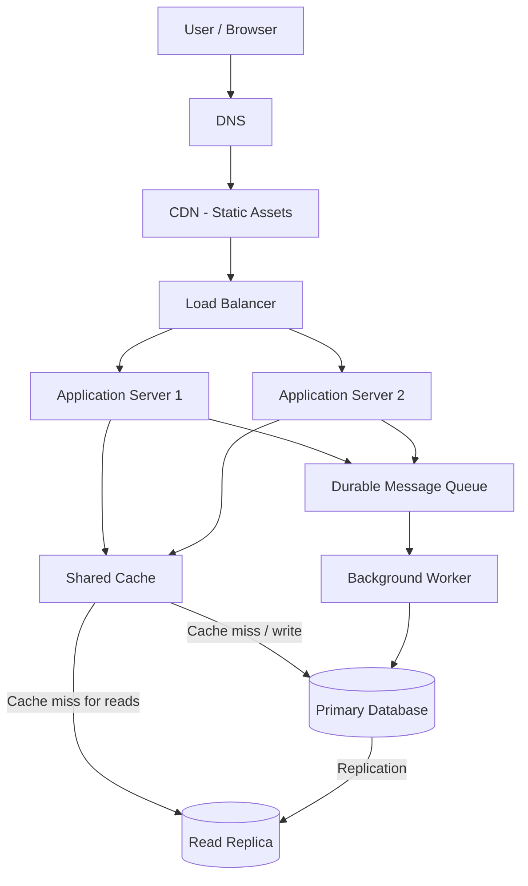

# QuickNotes System Architecture

## 1. Overview

QuickNotes is a notes application that allows users to create, view, update, delete, and organize notes with tags. This document describes a proposed scalable production architecture for one million registered users.

The architecture separates the frontend, application services, data storage, caching, and asynchronous background processing. The current frontend uses JSONPlaceholder for API practice; the components described here represent the intended production design.

## 2. Functional Requirements

1. Users can create an account and authenticate securely.
2. Users can create, view, update, and delete their notes.
3. Users can organize notes using tags.
4. Users can retrieve notes in pages and sort them by update time.
5. Users can access only their own notes.
6. The system validates inputs and returns meaningful error responses.

## 3. Non-Functional Requirements

- **Scalability:** support growth to one million registered users and increased request volume.
- **Availability:** continue serving requests if an application server fails.
- **Performance:** use caching, database indexes, and read replicas to reduce response times.
- **Security:** enforce HTTPS, authentication, authorization, and server-side validation.
- **Reliability:** use durable database storage, backups, and controlled retry mechanisms.
- **Maintainability:** separate application responsibilities and monitor each component.
- **Consistency:** ensure note creation and updates are committed to the primary database before reporting success.

## 4. Architecture Diagram

The CDN serves frontend assets such as HTML, CSS, and JavaScript. Dynamic API requests are routed through the load balancer to an available application server. The application servers share a cache and access the database tier. Background workers process tasks that do not need to finish during the user's request.

## 5. Component Responsibilities

### 5.1 Client

The browser displays the user interface and sends HTTPS requests to the API. Client-side validation improves usability, but the server remains responsible for enforcing security and data rules.

### 5.2 DNS

DNS resolves the application domain to the appropriate edge or load-balancing service. A managed DNS provider can support health-aware routing and resilient service discovery.

### 5.3 Content Delivery Network (CDN)

The CDN caches static frontend files close to users, reducing latency and the load on the origin infrastructure. Personalized note data must not be publicly cached. Any private API caching must be configured carefully to prevent one user's data from being served to another.

### 5.4 Load Balancer

The load balancer distributes incoming API requests across healthy application servers. Health checks remove unhealthy instances from rotation. Running at least two application servers avoids making one application instance the sole point of failure.

### 5.5 Application Servers

Two or more stateless application servers handle authentication, authorization, input validation, business logic, and API responses. Additional instances can be added as demand increases. Session state should be held in a shared service or represented by securely validated tokens rather than stored only in one server's memory.

### 5.6 Shared Cache

A shared cache, such as Redis, stores frequently requested data and reduces repeated database reads. Cache keys must include the relevant user or authorization scope. Updates and deletions must invalidate or refresh affected entries to prevent stale or unauthorized results.

### 5.7 Primary Database

A relational database such as PostgreSQL stores users, notes, tags, and note-tag relationships. The primary database handles writes and enforces constraints and transactions. Appropriate indexes support frequent queries, particularly retrieving a user's notes ordered by update time.

### 5.8 Read Replica

A read replica receives replicated data from the primary database and serves suitable read-only queries. This reduces read pressure on the primary. Replication can lag, so requests that require the latest write should use the primary or another consistency-aware strategy.

### 5.9 Message Queue

A durable queue holds tasks that can be processed asynchronously, such as notifications, audit-event processing, or search-index updates. Queue messages should be retried safely, and consumers should be idempotent so a repeated message does not produce duplicate side effects.

### 5.10 Background Worker

Workers consume queued messages and perform background tasks without keeping the user's HTTP request open. Workers can be scaled independently according to queue depth and processing latency. The queue and worker must not be the only way to commit a note's core data; the note should first be persisted successfully in the primary database.

## 6. Capacity and Load Estimates

### Assumptions

The following are planning estimates, not measured production traffic.

- Registered users: 1,000,000
- Daily active users (DAU): 10% of registered users = 100,000
- Average note reads per active user per day: 20
- Average note writes per active user per day: 2
- Average stored note content and basic metadata: approximately 2 KB per note
- Peak traffic assumption: 5 times average traffic
- Days per year: 365

### 6.1 Average Reads per Second

Daily note reads:

\[
100{,}000 \times 20 = 2{,}000{,}000
\]

Average reads per second:

\[
\frac{2{,}000{,}000}{86{,}400}
\approx 23.15
\]

**Estimated average: approximately 23 note reads per second.**

At a 5× peak factor:

\[
23.15 \times 5 \approx 116
\]

**Estimated peak: approximately 116 reads per second.**

### 6.2 Average Writes per Second

Daily note writes:

\[
100{,}000 \times 2 = 200{,}000
\]

Average writes per second:

\[
\frac{200{,}000}{86{,}400}
\approx 2.31
\]

**Estimated average: approximately 2.3 note writes per second.**

At a 5× peak factor:

\[
2.31 \times 5 \approx 11.6
\]

**Estimated peak: approximately 12 writes per second.**

These write estimates represent note creations and updates combined. Deletions and other operations would add further traffic.

### 6.3 Annual Storage Estimate

Assuming 200,000 new notes per day and an average of 2 KB per note:

\[
200{,}000 \times 2\text{ KB} = 400{,}000\text{ KB/day}
\]

Using decimal storage units, this is approximately 400 MB per day.

\[
400\text{ MB} \times 365
= 146{,}000\text{ MB}
\]

**Estimated raw annual note storage: approximately 146 GB.**

This is a simplified estimate of newly created note content and basic metadata. It excludes database indexes, user and tag records, updates, attachments, replicas, backups, logs, and operational overhead. If the average note size or number of notes created increases, storage requirements will increase accordingly.

### 6.4 Estimate Summary

| Metric | Average estimate | 5× peak estimate |
|---|---:|---:|
| Note reads | 23 requests/second | 116 requests/second |
| Note writes | 2.3 requests/second | 12 requests/second |

| Storage metric | Estimate |
|---|---:|
| New notes per day | 200,000 |
| Assumed size per note | 2 KB |
| Raw storage per year | Approximately 146 GB |

These estimates provide an initial sizing baseline. Actual infrastructure should be sized using load tests, production monitoring, and observed traffic patterns.

## 7. Request Flows

### 7.1 GET /notes

1. The browser sends `GET /v1/notes` over HTTPS.
2. DNS resolves the service domain.
3. The request reaches the load balancer, which selects a healthy application server.
4. The application server validates the user's authentication and permissions.
5. The server checks the shared cache for the requested user's notes and query parameters.
6. If suitable data is cached, the server returns it after ensuring the cache key and authorization scope are correct.
7. On a cache miss, the server retrieves notes from the read replica when eventual consistency is acceptable. Otherwise, it reads from the primary.
8. The application returns a paginated JSON response.
9. Any cache entry is populated or refreshed according to the caching policy.

The application should avoid returning notes that belong to another user, even if a client supplies a different user ID in a request.

### 7.2 POST /notes

1. The browser sends `POST /v1/notes` with a JSON body and authentication credentials.
2. DNS and the load balancer route the request to a healthy application server.
3. The application authenticates the user and validates the title and body.
4. The application inserts the note into the primary database.
5. The database commits the transaction and returns the created note ID and stored data.
6. The application invalidates or refreshes relevant cache entries.
7. If background work is needed, the application or a reliable event-delivery mechanism publishes a task to the durable queue.
8. The API returns `201 Created` with the created note.

The API must not report successful creation before the primary database confirms the write. If cache invalidation or queue publishing is required for correctness, the design should use a reliable strategy, such as a transactional outbox, rather than silently losing required work.

## 8. Trade-Offs

### Trade-off 1: Cache performance vs. data freshness

Caching lowers database load and can reduce response latency. However, cached data may become stale after updates or deletions. QuickNotes should invalidate affected entries and bypass the cache for operations that require strong consistency.

### Trade-off 2: Read replicas vs. consistency

Read replicas help scale read-heavy workloads, but replication lag can make a newly created note temporarily unavailable to a replica read. Read-after-write requests can be routed to the primary, while ordinary list requests may use a replica.

### Trade-off 3: Asynchronous processing vs. operational complexity

A queue keeps slow background work out of the user's request path and allows independent scaling. However, it introduces delivery retries, possible duplicate messages, monitoring requirements, and eventual consistency for background results. Use it only for tasks that benefit from asynchronous execution.

### Trade-off 4: More instances vs. cost

Multiple application servers and redundant infrastructure improve availability and allow horizontal scaling, but they increase operating costs. Start with a measured baseline and scale based on utilization, latency, and error rates.

## 9. Single Points of Failure and Resilience

The design reduces single points of failure through the following measures:

- **Application tier:** at least two application servers behind health-checked load balancing.
- **Database tier:** managed database high availability, automated backups, and a tested failover procedure. A read replica alone is not a complete high-availability strategy.
- **Cache:** a cache outage should degrade performance rather than make stored notes unavailable; the application can fall back to the database when safe.
- **Queue and workers:** use a durable, monitored queue, worker retries, and dead-letter handling for repeatedly failing tasks.
- **DNS and CDN:** use reliable managed services and appropriate health, caching, and failover configuration.
- **Monitoring:** collect request latency, error rate, database health, cache hit rate, replication lag, queue depth, and worker failures.
- **Recovery:** regularly test database restoration and disaster-recovery procedures.

No architecture removes every failure risk. High availability depends on actual service configuration, independent failure domains, monitoring, and tested recovery procedures.

## 10. Conclusion

QuickNotes can begin with a modest stateless application tier, a relational primary database, and a well-indexed data model. A load balancer, multiple application servers, carefully scoped caching, read replication, and asynchronous workers provide paths to scale as demand grows.

The initial planning estimate for one million registered users is approximately 23 average note reads per second, 2.3 average note writes per second, and 146 GB of raw new-note storage annually under the stated assumptions. These figures should be revisited as real usage data becomes available.